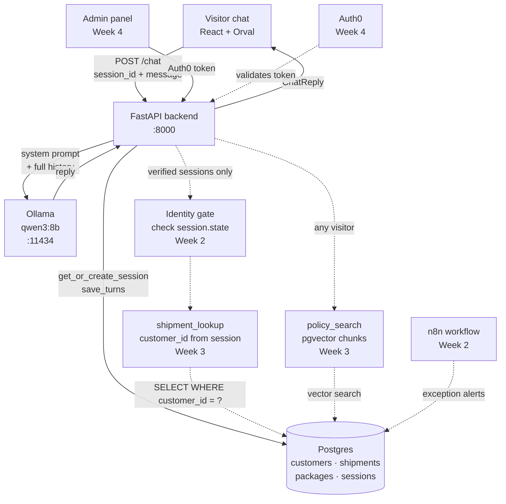

# Architecture sketch

## The parts that exist

- The visitor's chat window
- The backend
- The chat model runtime (Ollama)
- Postgres: customers, shipments, packages, chat sessions, and later your policy chunks
- Auth0, for the admin panel only
- The admin panel
- An n8n workflow, from Week 2
- A policy MCP server, from Week 4

## Sketch

## Questions

**Transport:** HTTP. A request-reply chatbot does not need a persistent connection.
HTTP is debuggable with curl and the browser network tab. Recorded in decisions.md as decision 2.

**Runtime:** Ollama. Local, free, works offline — no cost risk while iterating through
the workshop. DIAL is available as a secondary option but the allowance is limited.
Recorded in decisions.md as decision 1.

**Where is session state kept, and what does the browser hold?**
Session state lives in Postgres (`sessions` table): session ID, customer link (null until
verified), state (`anonymous` / `verifying` / `verified`), and the full transcript as JSONB.
The browser holds only the session ID in memory (`useRef`) — nothing is written to
localStorage or cookies. Whoever holds the session ID is that session.

**Where is the rule about shipment data enforced?**
In `shipment_lookup` in `app/db.py` (not yet built). It will check
`session.state == "verified"` and query with `WHERE customer_id = session.customer_id`.
The customer ID comes from the session record, never from the model's output or the user's
message. A prompt instruction alone cannot guarantee this — the check is in code.

**What does the model see, and what does it never see?**
The model sees: the system prompt, the conversation history (role + content pairs), and
tool results the backend chooses to pass.
The model never sees: database credentials, raw SQL, customer IDs, internal session state,
or another customer's data. The backend assembles what the model receives.

**What do you expect to change between this sketch and the final one?**
Week 2 adds the identity gate, the verification flow (6-digit code, modal), and the n8n
exception alert. Week 3 adds the tool loop and policy retrieval (pgvector). Week 4 adds
Auth0 and the admin panel. The core path — browser → backend → Ollama → Postgres — stays
the same throughout.